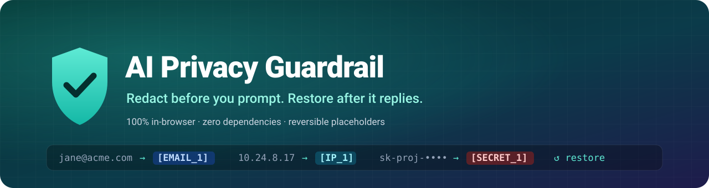
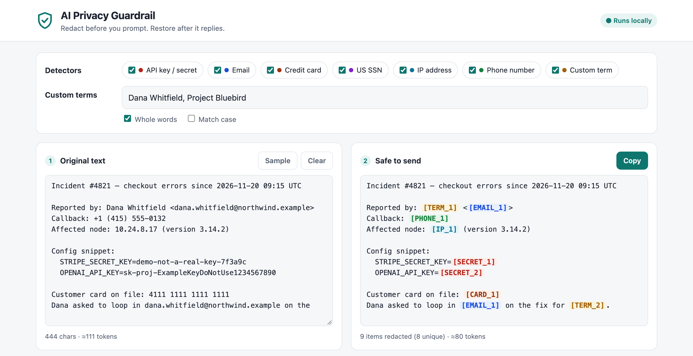
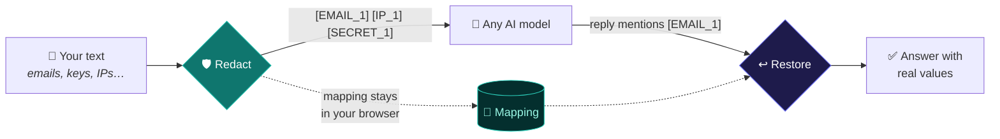

<div align="center">



<br />

<a href="https://liuxiaomingskm.github.io/AI-Privacy-Guardrail/"></a>
<a href="#-quick-start"></a>
<a href="#-use-it-in-code"></a>

<br />


**Stop leaking customer data, API keys and internal hosts into ChatGPT, Claude and Gemini —<br />without making the AI's answer useless.**

</div>

---

<div align="center">
<picture>
  <source media="(prefers-color-scheme: dark)" srcset="assets/screenshot-dark.png" />
  
</picture>
</div>

## ✨ Why it's different

Most redaction tools just black things out — and the AI loses track of *who* and *what* it's talking about. AI Privacy Guardrail keeps the structure and gives you the data back.

<table>
  <tr>
    <td width="33%" valign="top">
      <h3>🔢 Consistent placeholders</h3>
      The same value always gets the same tag — <code>[EMAIL_1]</code>, <code>[EMAIL_2]</code>, <code>[IP_1]</code> — so the model can still reason about entities.
    </td>
    <td width="33%" valign="top">
      <h3>↩️ Reversible</h3>
      Paste the AI's reply back in and every placeholder is swapped back to its real value. Locally.
    </td>
    <td width="33%" valign="top">
      <h3>🔒 Nothing leaves the tab</h3>
      No server, no analytics, no cookies, no CDN. Your text and terms are never stored.
    </td>
  </tr>
  <tr>
    <td width="33%" valign="top">
      <h3>🎯 Low false positives</h3>
      Luhn-checked cards, octet-validated IPs. Dates, versions, prices, UUIDs and code stay untouched.
    </td>
    <td width="33%" valign="top">
      <h3>🧩 Overlap-safe</h3>
      Detectors claim characters in priority order, so a keyword can never split an email or leave half a key visible.
    </td>
    <td width="33%" valign="top">
      <h3>⚡ Zero setup</h3>
      One HTML page, no build step, no <code>npm install</code>. The engine is also a reusable JS module.
    </td>
  </tr>
</table>

## 🔄 How it works



## 🧪 Before → after

<table>
<tr><th>📝 You paste</th><th>🛡️ The AI sees</th></tr>
<tr>
<td>

```text
Reported by: Dana Whitfield
  <dana@northwind.example>
Callback: +1 (415) 555-0132
Node: 10.24.8.17 (v3.14.2)
OPENAI_API_KEY=sk-proj-Ex…890
Card: 4111 1111 1111 1111
Ping dana@northwind.example
about Project Bluebird.
```

</td>
<td>

```text
Reported by: [TERM_1]
  <[EMAIL_1]>
Callback: [PHONE_1]
Node: [IP_1] (v3.14.2)
OPENAI_API_KEY=[SECRET_1]
Card: [CARD_1]
Ping [EMAIL_1]
about [TERM_2].
```

</td>
</tr>
</table>

Then the AI answers *"I'll email `[EMAIL_1]` and restart `[IP_1]`"* and you get back **"I'll email dana@northwind.example and restart 10.24.8.17"**.

## 🔍 What gets detected

| | Detector | Placeholder | Highlights |
|:-:|---|---|---|
| 🔑 | **API keys & secrets** | `[SECRET_n]` | `sk-…` (OpenAI / Anthropic / OpenRouter), AWS, Google, GitHub, GitLab, Slack, Stripe, Hugging Face, JWTs, `Bearer` tokens, PEM private keys, and `*_SECRET=` / `"api_key": "…"` assignments (only the value is replaced) |
| 📧 | **Email** | `[EMAIL_n]` | Case-insensitive grouping: `A@X.com` = `a@x.com` |
| 💳 | **Credit card** | `[CARD_n]` | 13–19 digits, **Luhn-validated** |
| 🪪 | **US SSN** | `[SSN_n]` | Skips invalid ranges (`000`, `666`, `9xx`) |
| 🌐 | **IP address** | `[IP_n]` | IPv4 with octet validation; ignores `1.2.3.4.5` style versions |
| 📞 | **Phone** | `[PHONE_n]` | International `+…` and 10–11 digit national formats |
| 🏷️ | **Custom terms** | `[TERM_n]` | Your names, clients, code names — whole-word & case options |

> [!TIP]
> Free-form data like people's names or street addresses can't be reliably pattern-matched. Add them as **custom terms** — they're kept in memory only.

## 🚀 Quick start

**Use it now:** open the **[live demo](https://liuxiaomingskm.github.io/AI-Privacy-Guardrail/)** and click **Sample**.

**Run it locally:**

```bash
git clone https://github.com/liuxiaomingskm/AI-Privacy-Guardrail.git
cd AI-Privacy-Guardrail
open index.html        # or: npx serve .
```

**Run the tests** (Node 18+):

```bash
npm test
```

## 🧰 Use it in code

`src/guardrail.js` is a dependency-free module that works in the browser (`window.Guardrail`) and in Node:

```js
const { redact, restore } = require('./src/guardrail.js');

const { text, mapping, counts } = redact(
  'Ping jane@acme.com about host 10.0.0.12 for Project Bluebird',
  { terms: ['Project Bluebird'] }
);
// text   → 'Ping [EMAIL_1] about host [IP_1] for [TERM_1]'
// counts → { email: 1, ip: 1, term: 1 }

restore('I contacted [EMAIL_1] and rebooted [IP_1].', mapping);
// → 'I contacted jane@acme.com and rebooted 10.0.0.12.'
```

<details>
<summary><b>⚙️ <code>redact(text, options)</code> options</b></summary>

<br />

| Option | Default | Description |
| --- | --- | --- |
| `enabled` | all on | `{ email: false, … }` to switch detectors off |
| `terms` | `[]` | Custom words or phrases to redact |
| `wholeWord` | `true` | Only match terms as whole words |
| `caseSensitive` | `false` | Match terms case-sensitively |

Returns `{ text, items, mapping, counts }`:

- `text`: the redacted string
- `items`: every match with `type`, `value`, `placeholder`, `start` and `end`
- `mapping`: `{ "[EMAIL_1]": "jane@acme.com", … }`, the input for `restore()`
- `counts`: matches per detector

</details>

<details>
<summary><b>📁 Project layout</b></summary>

<br />

```
index.html              Page markup
src/guardrail.js        Redaction engine (pure functions)
src/app.js              UI wiring
src/styles.css          Styles, light + dark
tests/guardrail.test.js Engine tests (node --test)
assets/                 Banner and screenshots
```

</details>

<details>
<summary><b>❓ FAQ</b></summary>

<br />

**Does my text get sent anywhere?** No. There is no backend and the page makes no network requests with your content. Only your detector toggles are saved, in `localStorage`.

**Does it work offline?** Yes. Once the page is loaded, everything runs locally.

**Is it a guarantee?** No. It's a pattern-based safety net. Always review the output before sending.

**Can I add my own detector?** Yes. Add an entry to `DETECTORS` in `src/guardrail.js` with a regex and an optional `check()` validator, plus a test case.

</details>

## 🗺️ Roadmap

- [x] Consistent numbered placeholders
- [x] Restore values in the AI's reply
- [x] Luhn-validated card detection
- [ ] IBAN and passport-style ID detectors
- [ ] Export / import the mapping to restore a session later
- [ ] Browser extension that redacts directly in AI chat boxes
- [ ] Regional detector packs (EU, UK, CN, …)

## 🤝 Contributing

Issues and PRs are welcome. For a new detector, include examples of text it **should** catch and text it **should not**, and add them to `tests/guardrail.test.js`.

## 📄 License

[MIT](LICENSE) © 2024 liuxiaomingskm

<div align="center">

<br />

**If this saved you from pasting a secret into a chatbot, a ⭐ helps others find it.**

</div>
